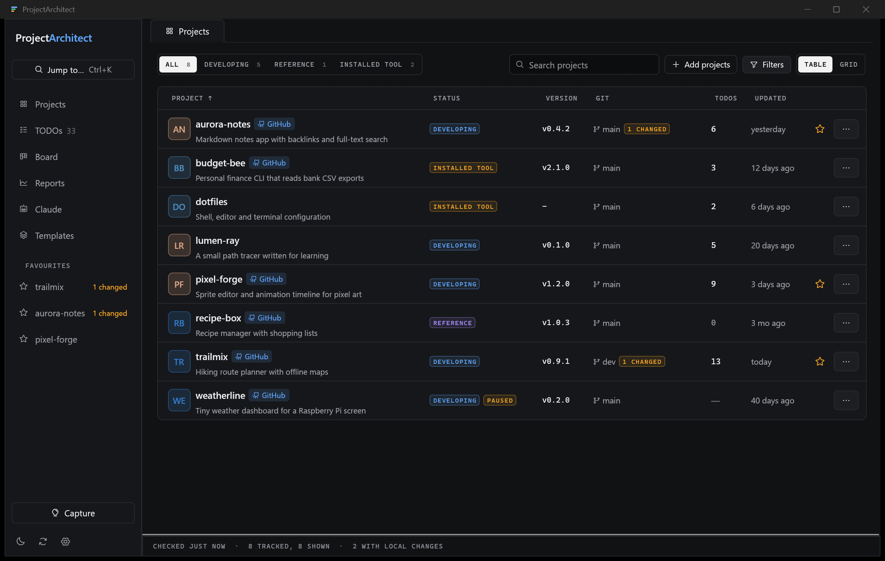

# ProjectArchitect

A local desktop app that keeps track of all your coding projects, wherever they are on disk: one overview of every
project, and a tab per project with its TODOs, roadmap, code TODOs, git state, tasks, notes and Claude Code config.
An MCP server and a command line give AI agents the same access as the UI.



## Features

- **Overview** of every project (table or grid): group, purpose, status, languages, version, lines of code, git
  state, GitHub link; favourites in the sidebar.
- **Project tab**: a dashboard of widgets, TODOs and roadmap (board, timeline, list, gantt) edited in the project's
  own files and style, code TODO/FIXME comments, notes, checkouts and worktrees, Git and GitHub panels, stored
  tasks with live output, dependencies between projects, Claude Code config.
- **Across projects**: a TODOs page with a query language and saved searches, a Board, Reports, a command palette
  (Ctrl+K) and Quick capture (Ctrl+Shift+K).
- **Templates**: create new projects from templates you can edit, or make a template from an existing project.
- **Claude Code config**: see and copy settings, skills and instructions (whole files, sections or JSON keys)
  between projects and your global `~/.claude`, with a diff and a backup before every write.
- **MCP server** (`pa-mcp`) and **CLI** (`pa-cli`): every action in the app is a tool for an agent or a script.

## What it touches

ProjectArchitect reads your projects; it writes into them only where a feature says so (TODO and roadmap files,
Claude config), losslessly, after checking the file did not change underneath it, and with a backup first for
conversions and overwrites (`%APPDATA%\ProjectArchitect\backups`). Git and GitHub go through the `git` and `gh`
command lines: the app never stores a token. Over MCP, anything that publishes (push, pull requests, GitHub repos
and issues) or writes Claude config is off until you enable it in Settings.

Tasks and templates run shell commands you (or an agent with MCP access) stored: treat them like scripts.

## Install

Download the latest installer from [Releases](https://github.com/J08K/ProjectArchitect/releases):

- **Windows**: `ProjectArchitect-<version>-x64.msi` (per-user, no admin rights). The installer is not signed, so
  SmartScreen may warn about an unknown publisher.
- **Fedora**: `sudo dnf install ./projectarchitect-<version>.x86_64.rpm`.

Requirements: [`git`](https://git-scm.com/) on PATH, and the [GitHub CLI](https://cli.github.com/) (`gh auth login`)
for the GitHub features and in-app updates (Settings → Updates).

### Use it from an agent

Settings → Agents registers the MCP server with Claude Code or Codex. By hand:

```bat
claude mcp add --scope user projectarchitect -- "%LOCALAPPDATA%\Programs\ProjectArchitect\pa-mcp.exe"
```

On the command line, `pa-cli tools` lists every tool and `pa-cli <tool> key=value …` runs one.

## Build from source

Rust 1.95 or newer:

```bash
cargo run -p pa --release
```

`cargo test --workspace` runs the tests. App data lives in `%APPDATA%\ProjectArchitect` (Windows) or the XDG data
folder (Linux); `--data-dir <folder>` points the app somewhere else, for example to try it without touching your
real data. [SPEC.md](SPEC.md) is the specification and its decision log, [ROADMAP.md](ROADMAP.md) the milestones.

## License

Licensed under either of [Apache License, Version 2.0](LICENSE-APACHE) or [MIT license](LICENSE-MIT), at your
option. Unless you explicitly state otherwise, any contribution intentionally submitted for inclusion in this
project by you, as defined in the Apache-2.0 license, shall be dual licensed as above, without any additional terms
or conditions.
